# Rewind a task's conversation to an earlier message

Status: draft spec (2026-11-10). Tracking issue: kmrosiek/cezar#3.
Brief: `.ai/specs/briefs/2026-11-09-conversation-rewind.md` — its Resolved-unknowns table is settled input.

## 📝 TLDR

Proposed: a **Rewind** action on a message the user already sent in a Claude task. It opens that
message (text and attachments) in an editor; on Send, cezar resumes the agent's session at the reply
before that message (`claude --resume <id> --resume-session-at <uuid>`), so the agent forgets
everything after it, and the transcript collapses the rewound messages behind a marker. Files are
not touched. Today a delivered message can never be taken back — a stray or wrong message keeps
steering the agent for the rest of the task.

## 📝 Problem Statement

A user who sends an unrelated, exploratory or wrong message into a task has no way back: the agent
keeps it in context, the next real instruction can go somewhere unexpected, and the transcript stays
cluttered. On `main` (`bf656d01`) a delivered message carries no actions — edit/remove exist only
while a task is queued (`packages/web/src/routes/task-thread/task-thread.tsx:288-319`) — and every
continuation resumes the same provider session (`packages/cezar/src/core/claude-cli-runner.ts:452-457`).
Claude Code solves this interactively with `/rewind`; cezar runs Claude headless and exposes nothing
equivalent. Evidence: one user's repeated reports; frequency is unmeasured.

## 📝 Proposed Solution

**Decisions** (brief + spec gate, 2026-11-10):

| # | Decision |
|---|---|
| Q1 | One spec, phased. After review: phase 1 is rewind end to end on desktop (engine, API, UI, docs) — a server-only phase would ship a risk-high route with no consumer; phase 2 is the mobile long-press menu. The scope review recommended moving phase 2 to its own spec (Copy / Select text are not rewind); kept here by the author's decision, and splittable without touching phase 1. |
| Q2 | Rewind is disabled while any task this one dispatched is still in flight. |
| Q3 | The rewound message's attachments come back into the editor and are re-sent unless removed. |

The flow, from the user's side:

1. Hover (desktop) or long-press (mobile) a message they sent → **Rewind**.
2. The bubble turns into an editor holding the message's raw text and its attachments, with the
   notice *"Conversation rewinds here · files stay as they are."* Cancel changes nothing.
3. **Rewind & send** → the agent's session resumes at the reply before that message with the edited
   message as the next turn. The rewound messages collapse behind *"↩ Rewound N messages · files
   unchanged · Show"*.

**Alternatives that lost** (detail in the brief): *rewind, then type* — needs a server-side
"cut but unsent" state every session writer would have to honour; a Claude.ai-style *Edit* label —
no room for a files option later; *Retry*; a blocking pop-up per rewind; restoring files in v1;
building nothing — "Open in…" → interactive `/rewind` leaves cezar's transcript out of sync and
needs a terminal.

**Research.** From product knowledge, not re-verified for this spec: Claude Code `/rewind` restores
conversation, code or both from per-prompt checkpoints, and its checkpoints miss shell-made changes;
Cursor and Cline offer per-message "restore checkpoint" over files and conversation (Cline through a
shadow git repository); OpenCode has `/undo`/`/redo` over messages and file snapshots; Codex CLI lets
the user back-track to a previous message and fork from it; ChatGPT and Claude.ai edit a message
into a navigable branch (‹ 1/2 ›). What they get right that v1 skips: **files** — every coding
agent couples them; the notice slot is where that lands later. What v1 avoids carrying: shadow
repositories, branch navigation and per-tool checkpointing.

## 📝 Architecture

```mermaid
flowchart LR
  UI["Cockpit: Rewind editor (new)"] -->|"POST /runs/:id/rewind (new)"| API["server.ts route family"]
  API --> RM["RunManager.rewindRun (new)"]
  RM -->|"settled run"| CR["continueRun / runContinuation (existing, + resumeAt)"]
  RM -->|"parked live session"| QC["quiet close → continue on drop (existing slot, new flag)"]
  QC --> CR
  CR --> CL["ClaudeCliRunner: --resume + --resume-session-at (new arg)"]
  CL -->|"turn-end.anchor, context-compacted (new v1)"| LOG["runs/RUN_ID.ndjson"]
  RM -->|"rewind event (new)"| LOG
  LOG --> TS["thread-state: collapse range, compaction divider (new)"]
  ELIG["rewindEligibility() in contract (new, shared)"] -.-> UI
  ELIG -.-> RM
```



Takeaway: one new route and one engine method; everything else is an additive field on paths that
already exist. The engine and the cockpit decide eligibility with **one pure function** so the
button and the server can never disagree.

- **Anchors.** The Claude runner remembers the `uuid` of the last `assistant` message it saw and
  puts it on the v1 `turn-end` it already emits at each `result` (`claude-cli-runner.ts:331`,
  `anchor?: string`). A rewind to user message *M* uses the latest anchored `turn-end` before *M* in
  the same session. The first message of a session has none, so it is never rewindable — by
  construction, not by a special case. **The anchor is taken only at `result`, never mid-turn.** A
  turn with tools is several `assistant` entries (verified: `thinking`, `tool_use`, `tool_use`,
  `text`); resuming at the final one keeps the tool results, while resuming at a mid-turn
  `tool_use` does **not** fail — the model silently loses the tool result ("the `ls` result never
  came back"). The `uuid`s arrive on the full `assistant` events with `--include-partial-messages`
  on, as cezar runs it, and match Claude's session file.
- **Compaction.** The Claude mapper drops every `system` message except `init`
  (`claude-ui-mapper.ts:129-130`). The runner now turns `system/compact_boundary` into a new v1
  event `context-compacted` (Codex keeps its existing `turn-end.reason`, #955). Claude cannot resume
  at a message before a boundary (verified: "No message found with message.uuid of …"), so an anchor
  older than the latest `context-compacted` of its session is ineligible.
- **Settled runs** (`done`, `failed`, `cancelled`, `review` — `CONTINUABLE_STATUSES`, `run.ts:553`)
  go through `continueRun` with a new `resumeAt` option, threaded into `AgentRunSpec.resumeAt` and
  from there into `buildClaudeArgs`.
- **Parked live sessions** (`waiting`, turn ended, process alive) are the common case and cannot take
  `--resume-session-at` — it is a process-start flag. `rewindRun` marks the owning `ActiveRun`
  `rewindOnDrop`, ends the session, and `dropActive` starts the continuation, the way
  `continueOnDrop` already does for a Continue posted during teardown (`run.ts:5251`). While the flag
  is set the session end is **quiet**: no `settleSuccess`, no auto-land, no notification, no status
  flip to `done`. Both turn-end handlers (streaming and non-streaming, `run.ts` ~5741/~7986) and
  both `ActiveRun` construction sites (`execute`, `runContinuation`) must honour it — AGENTS.md §
  *Changing a mechanism that already works*.
- **The agent's note.** The continuation's first content block is a cezar note — *"The user rewound
  this conversation to this point. Files in the working tree were NOT reverted; check `git status`
  before relying on their state."* — followed by the user's content. The `user-message` event
  records only the user's content.
- **Other runners.** `rewindEligibility` returns "Claude only" for every other backend; the route
  refuses them. No parity obligation: anchors are a v1 field, not a v2 capability-matrix row.

## 📝 Data Model

All additive; no `runs.json` field and no migration.

| Where | Change | Contract |
|---|---|---|
| v1 `AgentEvent` `turn-end` | `anchor?: string` — the provider's id of the turn's final assistant message (Claude: `uuid`). Absent = not rewindable. | BC §7, like `reason` (#955) |
| v1 `AgentEvent` | new type `context-compacted` `{ trigger?: 'auto' \| 'manual' }` | BC §7 additive type |
| `runs/<id>.ndjson` RunEvent | new type `rewind` `{ fromSeq, anchor, sessionId, count }` — events with `fromSeq ≤ seq < this.seq` are rewound | BC §3 additive type |
| `AgentRunSpec` | `resumeAt?: string` (only with `resume: true`) | runner seam (`agent-runner.ts:91-96`) |
| `ActiveRun` (in memory) | `rewindOnDrop?: { opts, anchor, fromSeq }` | not persisted |

Old recordings have no anchors, so their messages are simply not rewindable. An older cockpit that
does not know `rewind` shows the full transcript, which is a degradation, not a break.

## 📝 API Contracts

`POST /api/v1/runs/:id/rewind`, plus the `/api/v1/p/:projectId/…` alias, chained into the runs
family. Schemas live in `packages/contract/src/runs.ts`; validated as middleware.

```ts
rewindInputSchema = z.object({
  toSeq: z.number().int().nonnegative(),      // seq of the user-message being rewound
  text: z.string().max(100_000),              // the edited message (may be empty if images present)
  images: attachmentListSchema.optional(),    // same shape as continue/messages
  idempotencyKey: z.string().uuid().optional(),
}).refine(textOrImages)
rewindResponseSchema = z.object({ rewound: z.literal(true) })
```

Errors are `{ error }`: 404 unknown run; 409 when ineligible, carrying the eligibility reason
verbatim (turn running, Claude only, children in flight, before the latest compaction, earlier
session, no anchor, not a user message). It is idempotent per key, like `/continue`
(`continueReceipts`). Inventory it in `BACKWARD_COMPATIBILITY.md` §2 and pass
`contract-parity*`, `typed-bodies`, `route-parity` and `bc-route-inventory`.

`rewindEligibility(run, events, runs)` returns `{ ok: true, anchor, sessionId } | { ok: false, reason }`
and lives in `packages/contract/src/rewind.ts` — **not** the api-client, which the service may
import only in tests (AGENTS.md § Repository layout). The contract is Node-free, folded into the
published service by `scripts/inline-contract.mjs`, and re-exported to the cockpit by the
api-client, so it is the one place both sides can run the same function. Children-in-flight reuses
`inFlightChildren` (`run.ts:9637`), passed in as the `runs` argument so the function stays pure.

## 📝 UI/UX

- **Desktop (Phase 1).** The user bubble's existing hover/focus row (`thread-items.tsx:242`) gains
  **Rewind** (lucide `Undo2`, `aria-label="Rewind to this message"`). It is hidden when the reason is
  permanent and structural (non-Claude, first message, queued run), and disabled with the reason as a
  tooltip when it can change or explain (turn running, children in flight, before compaction,
  earlier session). On devices without hover the row stays visible, using the
  `[@media(hover:hover)]:opacity-0` pattern the tool rows already use (`thread-items.tsx:769`), so
  phase 1 never depends on a hover that touch screens lack.
- **Editor.** It reuses `UserBubble`'s inline editor (raw markdown), extended with attachment chips.
  The original images are fetched from their run URLs and staged like pasted ones (Q3), so the
  request needs no new attachment kind. Below the textarea sits the notice line, then **Cancel** and
  **Rewind & send**. Mod+Enter sends and Esc cancels. The draft surface `rewind:<seq>` (#939)
  survives leaving the task. One rewind editor is open at a time.
- **After.** A marker row replaces the rewound range: *"↩ Rewound N messages · files unchanged"*
  with a **Show** toggle that reveals them dimmed and read-only, with no actions inside. A
  `context-compacted` event renders as a thin *"Context compacted"* divider. It stays in scope because
  it explains the "before the latest compaction" disabled reason; without it the user cannot see
  where the line is. A rewind cannot be undone in v1; Show only reveals.
- **Mobile (Phase 2).** Long-press on a user bubble (`use-long-press.ts`, 450 ms, cancels on scroll)
  opens a menu: **Rewind** (or disabled with its reason), **Copy**, **Select text**. The bubble gets
  `-webkit-touch-callout: none; user-select: none` on touch, and **Select text** switches that one
  bubble to `user-select: text` until the next tap outside. **Copy** writes the raw text with honest
  failure feedback, reusing PR #1372's helper (upstream) if it has landed. Assistant messages are
  out of scope.

## 📝 Edge Cases & Failure Scenarios

- **Claude rejects the anchor** (pruned transcript, unseen compaction): the continuation fails. The
  engine writes a `note` (`tone: 'danger'`) — *"Rewind failed: … The conversation is unchanged; your
  message was put back in the composer."* It writes no `rewind` event, restores the edited text
  into the composer draft, and settles the run in its prior continuable state. The session is intact
  (verified), so a normal Continue still works. Status afterwards: a run that was already settled
  gets its prior status back; a run whose live session was quietly closed settles `failed` with the
  rewind error — continuable, and the honest state of a task with no live session.
- **Missing-session recovery** (`isClaudeMissingSessionError`, `run.ts` ~6045) starts a fresh
  session. Its earlier messages belong to the old session and become ineligible ("earlier session").
- **Workflow runs.** Only the latest session's messages, and never while the run waits at a graph
  step with work remaining.
- **A child report races the rewind.** Eligibility is re-checked inside `rewindRun` at apply time; a
  report that lands first makes the request 409 with the reason.
- **Double submit / retry** is covered by `idempotencyKey`.
- **Rewinding again** inside an already rewound range is impossible (no actions there); rewinding
  to a later message keeps working because the anchors stay valid in Claude's session tree.
- **In-place tasks.** The same behaviour, with files untouched. The quiet close must not hand the
  working-tree lease to another task between the close and the reopen; the continuation re-acquires
  it the way a parked in-place run does today.
- **Old cockpit, new server.** `rewind` events are unknown, so the transcript renders fully.
- **Tool-using turns** (verified 2026-11-10, Claude Code 2.1.319): resuming at the turn's final
  `assistant` entry works and keeps the tool output; a mid-turn anchor corrupts silently, which is
  why anchors are captured only at `result`. A turn interrupted before its `result` (cancel, crash)
  records no anchor, so the user message after it is not rewindable — safe, not wrong.

## 📝 Risks & Impact Review

- **risk-high by `SDLC.md`.** It touches the HTTP API (a new route), the runner seam
  (`AgentRunSpec.resumeAt`), the NDJSON format (two new event types) and v1 protocol (`turn-end.anchor`).
  Every change is additive, and old recordings replay unchanged.
- **The quiet close is the dangerous part.** A missed handler would settle a rewound run as `done`,
  auto-land an in-place task or fire a notification. Regression tests pin both turn-end handlers and
  both construction sites, and are proven red without the flag.
- **`--resume-session-at` is undocumented** (hidden in Claude Code 2.1.319). Mitigations: the
  mock and a fixture pin the behaviour cezar relies on; a CLI that drops the flag fails loudly at
  process start (unknown option), which takes the failure path above, so nothing is half-applied;
  the feature can be disabled by hiding the action without touching data.
- **Rollback.** Removing the feature leaves inert `rewind` and `context-compacted` events and
  `turn-end.anchor` fields, which older code ignores. Claude sessions stay valid.
- **Zero config.** On by default as a user-initiated action. It adds no env var, no network and no
  new telemetry event.

## 📋 Phasing

1. **Rewind on desktop, end to end.** Engine, API, the desktop Rewind action and editor, the rewound
   marker, the compaction divider and the docs page ship together, so the new route never exists
   without its one consumer. Steps 1–4 may land as separate commits or PRs; the action stays hidden
   until step 5.
2. **Mobile long-press menu.** Rewind · Copy · Select text on touch. Phase 1 already works on touch
   devices, because its action row stays visible where there is no hover. Phase 2 is ergonomics and
   can move to its own spec without touching phase 1.

## 📋 Implementation Plan

**Phase 1 — rewind on desktop, end to end**

1. **Runner.** `claude-cli-runner.ts` / `claude-ui-mapper.ts`: track the last `assistant` `uuid` and
   put it on the `turn-end` emitted at `result` (never mid-turn); map `system/compact_boundary` →
   `context-compacted`; `AgentRunSpec.resumeAt` → `--resume-session-at` in `buildClaudeArgs`.
   `scripts/mock-claude.mjs` emits `uuid`s, accepts the flag, and gains a `CEZ_MOCK_MISSING_ANCHORS`
   hook that fails the way the real CLI does. `cezar run`'s console renderer skips `context-compacted`
   quietly. *Test:* argv; a Claude golden fixture recorded from a real tool-using turn (`thinking`,
   `tool_use`, `text` entries) asserting the anchor is the final entry; mock; console replay of an old
   and a new recording.
2. **Eligibility.** `rewindEligibility` in `packages/contract/src/rewind.ts`, covering every reason,
   including an absent/empty anchor, a run with no events, and an anchor older than the latest
   compaction. *Test:* unit table; `npm run build` proves `inline-contract.mjs` carries it into
   `dist/contract/`.
3. **Engine + route, together** (the route has no behaviour without the engine): contract schemas,
   the `POST /runs/:id/rewind` route, and `RunManager.rewindRun` — the settled path via
   `continueRun({ resumeAt })`, the parked path via `rewindOnDrop` and the quiet close, the cezar
   note, `rewind` event ordering, the failure path with draft restore. Add the BC §2 inventory, and
   `AGENT_PROTOCOL.md` / BC §3 and §7 notes. *Test:* contract-parity, typed-bodies, route-parity,
   bc-route-inventory; engine tests under `CEZ_DRY_RUN` for both paths, both turn-end handlers, both
   `ActiveRun` construction sites, the in-place lease and the child-in-flight refusal. Regression tests
   are proven red via `git stash push -- <src>`.
4. **Transcript.** `thread-state.ts` / `session-transcript.tsx`: collapse `rewind` ranges into a marker
   with Show, and render the `context-compacted` divider. *Test:* thread-state unit and component tests,
   including an old recording with neither event.
5. **Action + editor.** `UserBubble` Rewind action and editor (attachments re-staged from their run
   URLs, notice, draft surface `rewind:<seq>`), wired through `task-thread.tsx` `messageActions` for
   sent messages and gated by `rewindEligibility`. *Test:* component tests (each gating reason,
   cancel, send, failure, attachments removed and kept).
6. **e2e + docs.** A dry-run smoke in `packages/web/e2e/` (needs steps 1, 3 and 5): send three
   messages, rewind the second, assert the marker and the new reply. Add
   `docs/site/content/docs/03-features/tasks-and-sessions/rewind.mdx` and a link from
   `continue-engine.mdx`. *Test:* `npm run test:e2e`, `npm run docs:check`.

**Phase 2 — mobile long-press menu**

7. Long-press menu on user bubbles for touch (Rewind · Copy · Select text), with the callout suppressed
   and per-bubble selection mode; Copy reuses PR #1372's helper (upstream) if it has landed. *Test:*
   component tests with `use-long-press`; the ios-sweep e2e; a docs page note.
